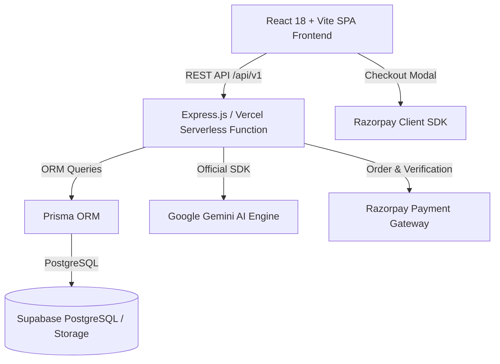

# AI Coaching Institute Performance & Fee Intelligence


> **Understand Performance. Predict Risk. Simplify Fees.**
> Next-generation AI-powered academic performance intelligence, explainable early warning indicator, and deterministic fee management for premier coaching institutes.

---

## 🌟 Key Features

### 1. 🎓 Comprehensive Student & Academic Management
- Full lifecycle student management with enrollment, courses, batches, and guardians.
- Interactive attendance logging (Present, Absent, Late, Excused) with calendar heatmaps and batch-level metrics.
- Assessment and examination engine with absent vs zero policy handling, score distributions, and subject-wise averages.

### 2. ⚠️ Signature Feature: Early Warning Intelligence
- **Explainable & Deterministic**: Multi-signal algorithmic risk scoring (0–100) combining attendance thresholds, score decline trajectories, consecutive absences, and missing assessments.
- **Categorized Risk Levels**: Low, Medium, and High risk profiles.
- **Evidence-Based Actionability**: Shows exact factual metrics behind every alert with recommended intervention workflows and assigned faculty tracking.

### 3. 💳 Advanced Fee Intelligence & Razorpay Gateway
- Deterministic integer-paise calculations (avoids floating-point errors).
- Course fee plans, installment schedules, scholarships, and auditable manual adjustments.
- Complete Razorpay integration with server-side order generation, HMAC-SHA256 signature verification, and idempotent webhook handlers.
- Automated receipt generation and overdue aging tracking.

### 4. 🧠 Grounded Google Gemini AI Assistant
- Server-side conversational AI utilizing the official `@google/genai` SDK.
- Institute-grounded responses ensuring metrics, student facts, and fee figures are strictly retrieved from real data.
- AI report summaries for management and one-click communication drafts (parent-teacher meetings, fee reminders, academic intervention).

### 5. 📊 Rich Analytics & 3D Interactive Visualizations
- Real-time KPI dashboard with comparative trend lines.
- Interactive 3D scatter and landscape visualizations (Attendance vs Performance vs Batches) powered by Three.js / Canvas.
- PDF and CSV report exports with institute branding.

---

## 🏗️ Architecture Overview



---

## 🚀 Quick Start (Local Setup)

### Prerequisites
- Node.js 18+ (tested on Node.js v24)
- npm 10+
- Git

### 1. Clone & Install
```bash
git clone https://github.com/LokeshGoud-lsk/ai-coaching-institute-intelligence.git
cd ai-coaching-institute-intelligence
npm install
```

### 2. Configure Environment Variables
Copy `.env.example` to `.env`:
```bash
cp .env.example .env
```
Fill in your credentials:
- `GEMINI_API_KEY`: [Google AI Studio](https://aistudio.google.com/)
- `RAZORPAY_KEY_ID` & `RAZORPAY_KEY_SECRET`: [Razorpay Dashboard](https://dashboard.razorpay.com/)
- `DATABASE_URL` & `DIRECT_URL`: [Supabase Project](https://supabase.com/)

### 3. Run Migrations & Seed Data
```bash
npx prisma generate
npm run dev
```

### 4. Start Development Servers
```bash
# In Windows PowerShell:
npm run dev
```
The application will be live at `http://localhost:5173`.

---

## 🧪 Testing

Run automated unit and integration tests:
```bash
npm run test
```

---

## 🚢 Deployment (Vercel)

1. Connect the GitHub repository `LokeshGoud-lsk/ai-coaching-institute-intelligence` on [Vercel](https://vercel.com).
2. Configure Environment Variables in the Vercel Dashboard matching `.env.example`.
3. Deploy! The configured `vercel.json` automatically routes `/api/*` to the serverless backend and serves the optimized Vite SPA bundle.

---

## 🛡️ Security & Privacy
- Strict tenant and institute data isolation.
- Zero secrets exposed to client-side bundles.
- Cryptographic verification for payment callbacks and webhook events.
- Audit logging for all sensitive administrative updates.
